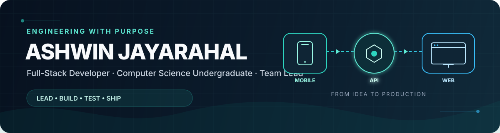

### Turning ideas into reliable products—and helping teams deliver them well.

I build across mobile, web and backend systems, with an interest in thoughtful architecture, strong collaboration and software that solves real problems.

---

## Engineering snapshot

| | |
|---|---|
| **Leading** | Sarvodaya Connect—a cross-platform digital society management system |
| **Collaborating** | Building practical Git education and platform security as a GitDojo organisation member |
| **Shipping** | Production websites and full-stack applications for real organisations |
| **Learning** | Distributed product architecture, secure APIs and dependable delivery workflows |

---

## Current focus

### 01 / [Sarvodaya Connect](https://github.com/sarvodaya-connect/sarvodaya-connect) · Team Lead

I lead the university project team and contribute across the product's architecture and delivery:

- Flutter mobile application for society officers
- Next.js administration dashboard
- NestJS backend API with shared TypeScript contracts
- PostgreSQL, Prisma and Docker infrastructure
- Authentication and multilingual onboarding flows
- Jira-based planning, pull-request reviews and automated testing

### 02 / [GitDojo](https://github.com/gitdojolearn/GitDojo) · Organisation member

As a member of the GitDojo organisation, I help build an interactive environment for learning Git through real commands, browser-based repositories and live visualisations. My work includes advanced recovery challenges, security headers, API rate limiting and a server-graded Git skills capstone.

---

## Selected work

<table>
<tr>
<td width="50%" valign="top">
<h3><a href="https://github.com/AshwinJay14/landslide-risk-monitoring-system">Landslide Risk Monitoring System</a></h3>

A full-stack environmental monitoring platform that evaluates sensor readings, classifies landslide risk and generates operational alerts.

<strong>Java · Spring Boot · JPA · Thymeleaf · MySQL · Docker</strong>

</td>
<td width="50%" valign="top">
<h3><a href="https://github.com/AshwinJay14/revera-ceylon-journeys">Revera Ceylon Journeys</a></h3>

A multilingual, production-ready travel platform with curated tours, responsive navigation, SEO metadata and a statically generated deployment.

<strong>Next.js · React · TypeScript · CSS</strong>

<a href="https://reveraceylon.com/">Visit live site →</a>

</td>
</tr>
<tr>
<td width="50%" valign="top">
<h3><a href="https://github.com/AshwinJay14/rl-associates-website">RL Associates</a></h3>

A professional website for a Sri Lankan audit and advisory firm, featuring accessible content, structured business data and automated quality checks.

<strong>Next.js · React · TypeScript · JSON-LD</strong>

<a href="https://rlassociates.lk/">Visit live site →</a>

</td>
<td width="50%" valign="top">
<h3><a href="https://github.com/AshwinJay14/products-api">Products API</a></h3>

A Spring Boot API project focused on clean backend structure, RESTful endpoints and practical Java development.

<strong>Java · Spring Boot · Maven</strong>

</td>
</tr>
</table>

---

## Technical toolkit

### Languages & frameworks

### Data, tooling & quality

---

## How I work

- Lead with clear requirements, practical architecture and shared ownership
- Plan delivery through Jira, focused branches and reviewable pull requests
- Test APIs and critical workflows before they become integration problems
- Build with security, accessibility and maintainability in mind
- Document setup and decisions so the whole team can move faster

---

## GitHub activity

---

### Let’s build software that earns its place in the real world.

[GitHub](https://github.com/AshwinJay14) · [LinkedIn](https://www.linkedin.com/in/ashwin-jayarahal-296511329/) · [Revera Ceylon Journeys](https://reveraceylon.com/) · [RL Associates](https://rlassociates.lk/)

